# Seiza for Windows

**A native Windows workspace for astronomy images, stacking, and parallax video.**

Open one image or a whole night of captures. Stretch FITS or XISF data, inspect
headers, plate-solve a frame, and see the stars and deep-sky objects in it. Turn
a finished image into a camera tour with depth, motion, and titles. Seiza pairs
a WinUI 3 interface and GPU-backed viewport with the shared
[Seiza](https://github.com/theatrus/seiza) Rust imaging core.

[Download Seiza for Windows 0.8.6 (x64)](https://github.com/theatrus/seiza-win/releases/download/v0.8.6/seiza-0.8.6-windows-x86_64.msi)
· [0.8.6 release notes](docs/releases/v0.8.6.md)
· [Previous versions](https://github.com/theatrus/seiza-win/releases)

**Also from Seiza:** [Core, CLI, and libraries](https://github.com/theatrus/seiza) ·
[Seiza for Mac](https://github.com/theatrus/seiza-mac) ·
[FITS and XISF for Photoshop](https://github.com/theatrus/xisf-photoshop)

## Features

- **[Parallax videos and tours](#parallax-videos-and-tours)** — Turn an astrophoto into a depth-aware camera tour with painted dust and title cards, then export video or lossless PNG frames.
- **[Image viewing and folder review](#image-viewing-and-folder-review)** — Browse nested capture folders with collapsible path, filter or file-type groups, cached thumbnails and fast previews.
- **[Stretch and image processing](#stretch-and-image-processing)** — Build live stretch recipes, correct backgrounds, and apply light deconvolution.
- **[Directory and live stacking](#directory-image-stacking)** — Align and combine selected frames or [watch a capture folder](#live-folder-stacking), with calibration, shared-reference alignment, and resumable sessions.
- **[Plate solving and sky overlays](#plate-solving-and-sky-overlays)** — Solve locally, identify stars and deep-sky objects, and export WCS solutions.
- **[Star and tilt measurement](#star-and-sensor-tilt-analysis)** — Measure stellar quality and sensor tilt, with optional parallelogram and triangle diagrams.
- **[Catalogs and distance data](#catalogs-and-distance-data)** — Download and verify solver catalogs and offline parallax distances from native controls.
- **[Image export and Explorer integration](#image-export-and-explorer-integration)** — Save full-size images with overlays and preview FITS/XISF files in Windows Explorer.

## Parallax videos and tours

Turn a finished image into a fly-in or multi-stop video tour.
Star-catalog distances and adjustable scene depth make
nearby stars move against the nebula as the camera travels. Plan a route
yourself or generate one, then preview and export it in a native Windows editor.


### Watch the results

These published examples use Seiza's shared parallax renderer. Click a preview
to open its video player on theatr.us; the gallery includes both landscape and
portrait compositions.

| Iris Nebula · NGC 7023 | The Question Mark · Sh2-171 / Sh2-170 |
| --- | --- |
| <a href="https://theatr.us/gallery/detail/astrobin/iris-nebula/288w86"></a> | <a href="https://theatr.us/gallery/detail/astrobin/big-q/29k8tr"></a> |
| [Watch the landscape tour](https://theatr.us/gallery/detail/astrobin/iris-nebula/288w86) | [Watch the portrait tour](https://theatr.us/gallery/detail/astrobin/big-q/29k8tr) |

Images and videos by [Yann Ramin (theatrus)](https://theatr.us/), from the
[AstroBin gallery collection](https://theatr.us/gallery/astrobin). Also watch the
[hosted tour on seiza.fyi](https://seiza.fyi/)
([direct MP4](https://seiza.fyi/media/parallax-tour.mp4)). The gallery examples
are HEVC; playback depends on your browser's codec support.

### Make your own

Open an image and choose **Parallax video…** from the toolbar's More options
menu. Import aligned starless and unscreened-stars layers, or optionally use a
separately installed RC-Astro CLI (`rc-astro.exe`) licensed for StarXTerminator.
Choose that executable once under **Settings > External tools**; Parallax
reuses the saved path across windows and app restarts.
Manual-layer solving uses the selected stars even when the viewer contains
the starless image.

- Generate a multi-stop tour on the prepared scene or pick destinations directly
  on the image. Edit travel, holds, zoom, pan, roll and target depth; save and load
  portable tour itinerary JSON with artwork references.
- Choose **Fill frame** or **Show whole image**, match the frame to your image's
  shape, or draw a source crop. **Pull Back** widens a stop while retaining its
  target, depth and timing; requested/fitted values explain camera adjustments.
- Preview, play and scrub your camera move. Tune star and background depth,
  use offline distance catalogs, and add object labels, a credit logo and
  opening, closing or per-stop title-card images.
- Paint a dust-opacity map with soft paint/clear brushes, undo and redo, or
  choose an existing map. Export current or counted dust as 16-bit PNG/TIFF or
  float FITS/XISF. Camera edits are preserved when changing dust.
- Export silent MP4 in landscape or portrait, with presets up to 4K and native
  H.264/HEVC encoding; PNG sequences are lossless. Optional existing FFmpeg
  enables MOV/MKV export. Native HEVC requires an available Windows encoder.
- Keep your source images untouched. The independent workspace retains a
  private snapshot after the viewer closes, and a cancelled export preserves
  an existing movie.


**Automatic depth planes** let catalogued nebulae
at different distances and foreground dust clouds move on planes of their own.
Inspect the detected planes, give any named object a distance of your own,
or add a custom image-mask plane with an explicit name and distance.

See the [Windows parallax guide](docs/PARALLAX-VIDEO.md) for layer requirements,
camera and tour controls, encoder availability and export limits. Windows
0.8.6 uses Seiza/C ABI 0.44.2, stacking 0.51.2, parallax
0.19.2 and image-io 0.11.0 from published crates.

## Image viewing and folder review

Open FITS, XISF, PNG, JPEG, and TIFF images, folders, or dropped files. Browse
naturally sorted image sets in a cached thumbnail rail without blocking the UI.
**Open folder** includes nested subfolders. Group the sidebar by **Folder Path**
(relative path), **Filter**, **File type**, or **None**, and turn **Include subfolders** off
to review only the selected folder. Changing grouping keeps the selected image
and its cached thumbnail. Group headers collapse and expand their thumbnails;
Previous/Next and keyboard navigation visit every image in grouped order,
automatically expanding a collapsed destination group and revealing its card.
Filter grouping uses the stacker's filename detection, with unrecognized files
under **Other**. Collapsing the current image's group does not close that image.
Unreadable subfolders and linked folders are skipped with a count in the sidebar.
Fit, pan, wheel-zoom, and pointer-anchored pinch-zoom a GPU-backed viewport;
overlay geometry and labels stay registered to image pixels.

Work in multiple independent document windows. Reopening an already-open file
focuses its window, while additional file activations stay in the same Seiza
process and open a new document window. Inspect image statistics, input/display
RGB histograms, searchable source headers, and processing provenance.

| Folder Path grouping | Filter grouping |
| --- | --- |
|  |  |

Native sidebar controls shown with synthetic sample images.

## Seiza for Windows 0.8.6: GPU stacking, mosaics and color tools

This release adopts published Seiza/C ABI **0.44.2**, stacking
**0.51.2**, parallax **0.19.2**, and image-io **0.11.0**. Blind solving now uses
Seiza's faster candidate search and full-catalog refinement. In an earlier local
0.40.1 warm-cache comparison against 0.39.0, Tulip solved in **0.35 s instead of
2.02 s**, and Big Q in **0.65 s instead of 2.67 s**, with lower RMS.
Timings depend on the image, hardware and catalog.

Batch stacking offers **automatic coordinate-based panel grouping**: select
lights, enable **Group mosaic panels by solved coordinates**, then **Solve and
group selected lights**. Review sky fields and check whole panels or individual
exposures before stacking; unrelated fields and unsolved files stay separate.
Manual selection offers **Fixed reference frame** or **Expanded mosaic /
dithered edges**, with a canvas memory limit, a 5% default overlap, existing
registration and normalization choices, and visible planning/lens notes. See the
[mosaic stacking guide and validation notes](docs/MOSAIC-STACKING.md) for limits,
measurements, and compatibility details.

The viewer also opens mosaics wider or taller than 16,384 pixels
using on-demand GPU tiles at full resolution. Clipboard and image exports avoid
an oversized GPU bitmap, including when exporting overlays. CPU memory and
output-format limits still apply.

**Settings → Stacking performance → Use GPU for stacking** controls acceleration
for new batch and live stacks, including defect learning and reintegration.
It defaults to automatic GPU use; turn it off for CPU-only processing. Small
frames and unavailable GPU operations fall back to the CPU. **GPU planning
budget** lets you reserve room for other programs; 0 uses the device capacity.
It controls accumulator placement and reintegration bands, rather than imposing
a hard allocation ceiling. Active stacks keep their settings; resumed stacks
use the current GPU mode and budget while preserving accumulated frames. Both
preferences survive app restarts. GPU and CPU floating-point results need not
be byte-identical.

Expanded canvases reject **Local** normalization before planning; use **Local
background**, **Global**, or **None**. The updated core also prepares planning
frames ahead, scores blind registration candidates in parallel, and runs
RC-Astro tools without opening console windows on Windows.

| Solve and group input lights | Review panels and individual exposures |
| --- | --- |
|  |  |

| Expanded canvas controls | Persistent GPU preference |
| --- | --- |
|  |  |

These are native UI captures of the released controls. The panel examples use
crops and repeated copies of an M31 image to demonstrate selection, not
independently captured mosaic exposures. No original exposures were modified.

New [narrowband, continuum and RGB star tools](docs/COLOR-TOOLS.md) follow a
preview-first flow with optional settings collapsed. Build HOO/SHO palettes,
review stellar continuum fits before signed subtraction, and stretch or restore
RGB star layers. A borderless 20,480 × 11,520 M31 upscale loaded and solved in
the app in 1.17 s, with 456 matched stars and 0.468 arcsec RMS; it is resampled
validation data. Folder browsing also follows Windows image shortcuts and
deduplicates their targets. See the [0.8.6 release notes](docs/releases/v0.8.6.md).


## Seiza for Windows 0.8.5: multi-filter sessions, flat review and color stacking

- Watch one parent **LIGHT** folder and run independent filter stacks as captures
  arrive. View all filters together or select one for detailed inspection.
- Change between Auto MTF, Median Anchor and Layered previews during a session,
  including while paused, while keeping the linear stack unchanged.
- Review flat illumination, clipping, dust and geometry before building masters;
  inspect warnings and explicitly continue or cancel each calibration review.
- Combine aligned saved channels into RGB or LRGB, with optional Gaia color
  calibration, and learn fixed sensor defects from compatible dithered lights.
- Choose RC-Astro once in Settings and reuse it across Parallax sessions. Changes
  wait for current rendering work to finish. Browser grouping is remembered too.
- Preserve completed-filter state durably and protect every filter's capture,
  calibration and checkpoint files when saving results.

See the [0.8.5 release notes](docs/releases/v0.8.5.md) for details.

## Seiza for Windows 0.8.4: framing, cropped dust and reliable pull-back

- Frame the whole image, fill the video, match its aspect ratio, or draw a
  non-destructive source crop. Dust editing and saved tours keep their alignment.
- Pull back an off-centre target without magnifying the opening. Dolly and Zoom
  have independent sliders and resets; stop selection seeks its arrival.
  **Transition zoom** explains temporary fitting between two-stop turns.
- Use original FITS/XISF astrometric headers, reuse viewer solutions, and solve
  aligned Stars directly for known starless sources. Unconfirmed headers are
  explicitly marked unverified, and solving supports cancellation/time limits.
- Check for updates through the signed feed at **seiza.fyi**.


See the [0.8.4 release notes](docs/releases/v0.8.4.md) for details.

## Seiza for Windows 0.8.3: nested folders and grouped browsing

- Open a capture tree at once, or turn **Include subfolders** off for just its
  root folder. Group by **Folder Path**, **Filter**, **File type**, or **None**.
- Collapse groups without losing the open image. Left/Right and Previous/Next
  visit every image in grouped order, expanding the destination group as needed.
  Regrouping or reopening the sidebar reveals the selected card without
  resetting the document, solve, overlays or viewport.
- Stack FITS/XISF frames from the entire opened tree, including collapsed
  groups. Choose frames explicitly in the stacking dialog; relative paths
  distinguish duplicate filenames in the frame and reference lists.
- Keep directory scans cancellable and report skipped linked or unreadable
  subfolders instead of recursing into descendant junctions.

Filter groups use filename detection, not image headers; grouping choices are
per-window. Native crate versions are unchanged from 0.8.2. See the
[0.8.3 release notes](docs/releases/v0.8.3.md).

## Seiza for Windows 0.8.2: depth-aware tours, painted dust and more exports

- Generate editable tours on the prepared scene, keeping the depth of each
  destination and the scene's distance reference. Set explicit stop depths,
  custom mask-defined planes and arbitrary named object distances.
- Paint or clear dust with soft brushes and undo/redo. Applied maps persist
  across preparation, while cancelled edits preserve the current map.
- Add a logo and opening, closing or stop title cards; move saved itineraries
  with portable artwork references. Plane metadata refreshes correctly.
- Export native MP4, lossless PNG sequences, or MOV/MKV through optional
  FFmpeg. Original and previously selected inputs stay protected from export
  overwrites; failed or cancelled jobs preserve existing files.
- Refresh the FITS/XISF shell-reader dependencies with bounded decoding and
  compatibility fixes for the updated XML parser.

This release retains shared-reference filter stacking and resumable live
stacking from 0.8.1. See the [0.8.2 release notes](docs/releases/v0.8.2.md),
[shared-reference guide](docs/STACKING-UPSTREAM.md) and
[parallax guide](docs/PARALLAX-VIDEO.md).


## Seiza for Windows 0.7.6

This point release fixes missing image thumbnails in the directory sidebar.
The existing Auto MTF PNG previews now decode and display correctly instead
of silently failing when their stream closes too early.

Existing cached thumbnails work after updating; you do not need to clear the
cache. Source images, thumbnail stretch settings, processing defaults, and
stacking behavior are unchanged. This release retains Seiza 0.19.0 and stacking
0.20.0.

## Stacking controls introduced in 0.7.5

Version 0.7.5 exposed the new stacking controls in the published Seiza
0.19.0 core and stacking 0.20.0, in both directory and live stacking.

- Choose similarity, affine, or quadratic registration. Polynomial models
  correct distortion after star matching and retain similarity when there are
  too few matched stars to fit the requested model.
- Choose the reference automatically from selected raw lights, independently
  for each directory filter group. Live stacking can score compatible existing
  lights at startup; empty folders start with the first stable light, and
  resumed sessions retain their saved reference.
- Match local backgrounds without applying independent tile gains, and weight
  frames by inverse noise variance with adjustable bounds.
- Choose bilinear or sharper Lanczos-3 resampling, VNG/MHC/bilinear Bayer
  demosaicing, or Bayer drizzle for sufficiently dithered capture sequences.
- Optionally suppress hot/dead pixels before demosaicing. Existing stacking
  defaults remain unchanged, and new nondefault choices are part of saved
  session identity.
- Transient removal now reports all three native passes. Local background
  normalization uses an integrated reference; source images remain untouched.

| Reference and registration | Resampling and sensor pixels |
| --- | --- |
| 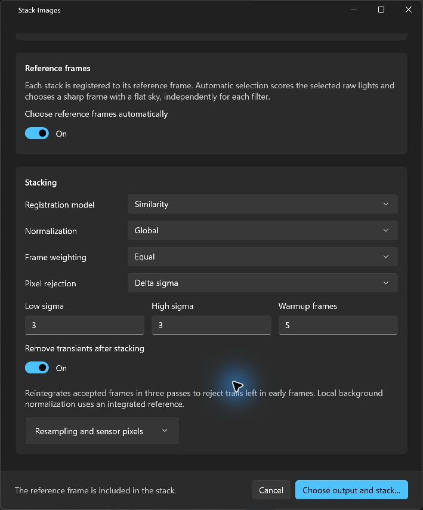 | 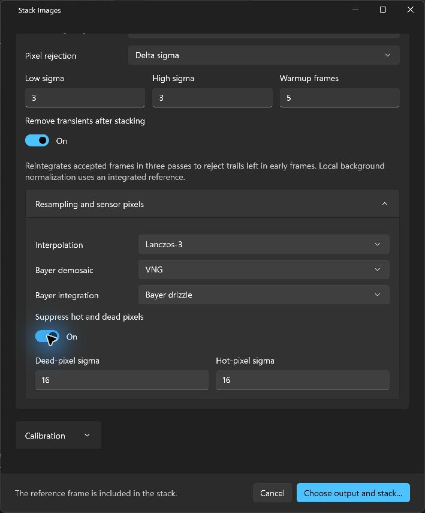 |

## XISF files

Seiza for Windows 0.7.3 moved to a core whose XISF reader follows the XISF 1.0
Revision 1 specification.

- Open XISF images whose pixels PixInsight stores inside the file header, as
  it does for small images, and images stored pixel by pixel.
- Open compressed XISF data split into subblocks, including subblocks
  PixInsight stores uncompressed.
- Show CIELab XISF images in color, converted to RGB.
- Open a file's main image even when another image in it uses a format Seiza
  cannot read.
- Explorer thumbnails and Preview Pane images use the same reader.

## Smoother image previews

Seiza for Windows 0.7.2 reduced graininess when you view images at a small size.

- Average source pixels when building smaller previews, including Explorer
  thumbnails and Preview Pane images, instead of picking isolated pixels.
- Filter scaled images in the viewer and live-stack window. The viewer accounts
  for display DPI and the preview bitmap's size, and keeps nearest-neighbor
  sampling for native-resolution pixels at 1:1 and above.

These changes affect display sampling, not the source image or stretch settings.

## Star and sensor-tilt analysis

- Use **Analyze stars** for FITS and XISF images. This is
  independent of plate solving and catalog downloads: the native core decodes
  the source file directly, measures HFR/FWHM, and returns a nine-cell sensor
  tilt summary. The Windows inspector and overlay menu keep these measured
  stars distinct from plate-solve detections. Interactive analysis first runs
  the bounded binning-2, sensitivity-30 pass; if it measures fewer than 200
  stars, the core retries with a relaxed SNR gate and, if still below target,
  native-resolution unblurred detection. It returns one complete pass rather
  than merging measurements from different scales.

During 0.7.1 validation, a registry-backed managed end-to-end test increased a
real C925 FITS image from 71 strict-pass stars to a 146-star
adaptive pass with all nine cells reliable. A dense real XISF image stayed
bit-for-bit identical at 468 stars because its first pass met the target;
both returned a ready native triangle. The test preserved the exact native
triangle data and formulas and confirmed that analysis did not modify either
source. Measured-star circles, the sensor-tilt grid, and the optional
**Parallelogram tilt diagram** and **Triangle tilt diagram** use the same
image-space overlay scene for the live viewport and full-resolution 8- or
16-bit composited export. The Triangle diagram consumes three native adjustment
regions and becomes available only when their native readiness verdict is
satisfied. Direction lines remain hidden unless the native response explicitly
guarantees normalized major-axis orientations; sparse regions are withheld,
and tilt should be confirmed across multiple frames rather than inferred from
one exposure.

| Measured stars and sensor grid | Parallelogram tilt diagram |
| --- | --- |
| 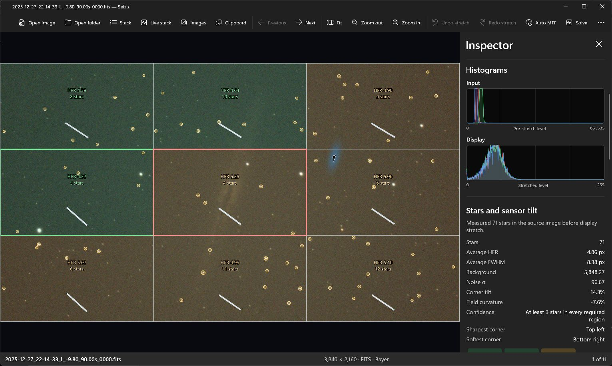 | 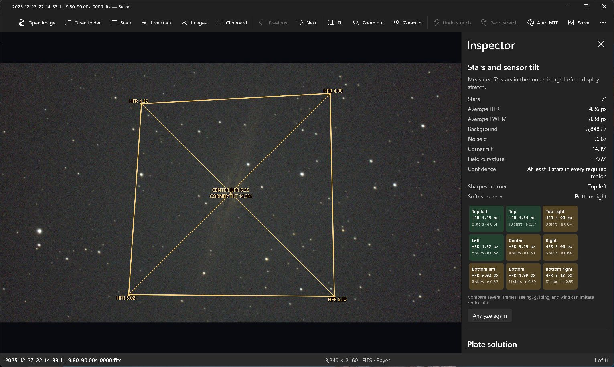 |

## Native Explorer previews and thumbnails

The all-users MSI registers Seiza's native thumbnail and Preview Pane providers
for `.fit`, `.fits`, `.fts`, and `.xisf`. Explorer hosts them in isolated shell
processes; neither component loads WinUI, .NET, catalogs, or solving code.
Thumbnail and preview rendering is bounded for large inputs, and install,
repair, and uninstall notify the shell immediately so associations refresh
without a Windows restart.

| FITS capture sequence | XISF processing folder |
| --- | --- |
| 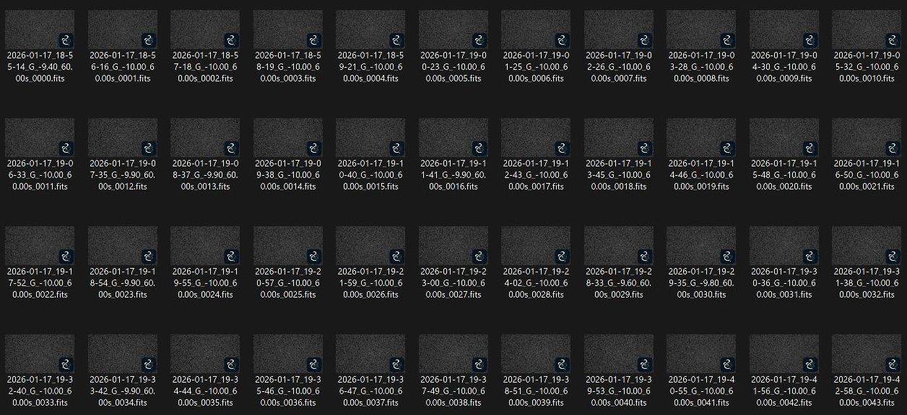 | 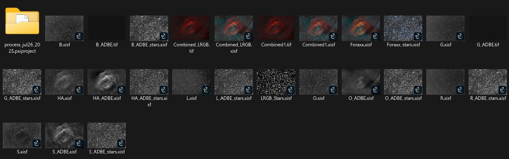 |

## Color stacking and calibration

Open **Color stacking** from the main toolbar to combine linear R, G and B
stacks, optionally with luminance, or calibrate an existing RGB/OSC stack.
Channel stacks must already share an alignment reference and pixel grid;
matching dimensions alone are not enough. Save stable snapshots from each
live filter stack first. Composition does not perform another registration.

Gaia calibration is intended for broadband color, not narrowband palettes.
The dialog can explicitly download the offline Gaia photometry catalog into
the configured catalog directory. The default workflow solves/verifies the
composed image using your solve catalogs, then performs native photometric
calibration before any display stretch. Turning verification off uses the
image's existing WCS. Missing catalogs, insufficient stars and other skipped
outcomes are reported without publishing a partial result.

Results are separate linear FITS or XISF files; source stacks are never
modified. Output is staged beside the destination and published only on
success. Calibrated files retain their WCS and a `SEIZAPCC=GAIA` marker.
Seiza uses linked RGB or luminance-preserving stretches for marked files on
reopen, preview and display export, keeping their calibrated color balance.
An already marked image cannot be calibrated again; use its original stack.

The **Narrowband, continuum and RGB stars…** button opens the new color tools:
HOO/SHO display balance with optional broadband structure and green reduction,
validated stellar continuum fitting and signed linear subtraction, independent
RGB star stretching, and restoration of either linear-extracted or already
prepared stars. Inputs must be registered FITS/XISF snapshots. Fits are reviewed
before subtraction and saved plans are bound to exact source hashes.
The dialog shows required sources first, with optional processing settings
collapsed. **Build preview**, review the image, then **Save image…**;
continuum analysis shows its fit before building the subtraction preview.
Display results reopen with No Stretch and an explicit 0–1 range; continuum residuals
remain linear, including negative values. See [Color tools](docs/COLOR-TOOLS.md)
for the required input scales, clipping information and fit reports.
Current adoption checks and smoke-test timings are recorded in
[Windows validation](docs/SEIZA-0442-VALIDATION.md).

Directory and live stacking also offer **Learn sensor defects from dithered
lights (no master dark)**. This opt-in native hot/dead-pixel map needs at least
three compatible lights and actual dithering or drift; stationary stars can
otherwise resemble persistent sensor defects. Do not enable it with a master
dark. Live stacks wait for three compatible frames per filter, learn once,
and retain that fixed map in their checkpoint, including after restart without
the original captures. Changing this policy or its calibration masters requires
a new stack, so a learned correction cannot be combined with a new dark.

Calibration-master caches use the native stacking-output version, so unrelated
core releases no longer force identical masters to be rebuilt.

## Flat quality review

In directory or live stacking, choose automatic calibration and enable
**Review flat quality before stacking**. This follows the workflow in
[Mac #76](https://github.com/theatrus/seiza-mac/pull/76): native Seiza measures
the exact selected raw flats, even when the master is reused from cache.
The Calibration Review dialog shows reviewed/suspect/poor counts, individual
flagged frames, preparation warnings, and a separate combined-master prediction.
Continue keeps the same selection; Cancel stops before processing lights.
There is no automatic exclusion, reordering, or replacement of flats.

Set **Saturation level** to the file's raw units (commonly 65535 for 16-bit ADU
or 1 for normalized samples). Optional **Estimate dust distance** needs focal
ratio, pixel size after camera binning, and obstruction diameter as a percentage
of the aperture. For 3.76 µm pixels with 2×2 binning, enter 7.52 µm. Distances are
estimates, not identification of a dirty surface. Steady dust is what flats
correct; vignetting is reported separately, and detection counts across frames
are not counts of unique particles.

Expand **Dust and vignetting details** for more information. The first ten
flagged frames appear initially; **Show all** reveals the rest. **Copy Report**
always includes every finding, native value/limit, illumination grid and feature
geometry, including collapsed details. The combined-master verdict predicts the
selected set; it does not measure the built master or determine which flat
session best matches a light. Existing metadata and pedestal safety gates remain
in force.

Multi-filter live sessions review each new filter before it starts ingestion.
Cancelling one filter's review leaves other filters running; pause/resume the
session to retry. Restored checkpoints retain their existing calibration and do
not invoke a new raw-flat review. Reviews are not cached or persisted. Failed
reviews show an explicit incomplete-review warning, never a passing partial
result. Cancellation waits for the current native measurement to return and
discards the result; source identities are checked around the whole review.

## Directory image stacking

- Directory image stacking registers and combines selected FITS or XISF
  light frames into an unstretched 32-bit floating-point FITS image.
  When **Include subfolders** is on, **Stack** offers FITS/XISF frames from the
  entire opened tree, including collapsed groups. Turn it off to limit inputs
  to the opened folder. Choose light frames in the stacking dialog; relative
  paths distinguish same-named files in its frame and reference lists.
- Stacks can be split automatically by filename filter, with an independent
  reference frame for each filter group. Global or local normalization,
  delta-sigma rejection, registration limits, and calibration match the macOS
  workflow. Choose existing masters or point Seiza at raw bias, dark,
  dark-flat, and flat frames; the shared core matches camera metadata and
  proves one safe calibration set against every target light in each group
  before building the dependency chain. Matching uses target, proximity,
  alternate-anchor, and coherent session passes; a recognized filename filter
  can identify a target light whose FILTER header is missing, while an
  unresolved target filter withholds flat calibration. Final native admission
  reports every accepted input and every skipped input with its reason, and
  Windows verifies that provenance before publishing or caching a master.
  Windows then rechecks the written master so its preserved sensor and optics
  metadata must still match every target light. A selected frame that cannot
  be inspected, or that is not a raw light — a master, or an already
  calibrated file — is set aside from matching with a warning; the stack
  still runs, and native per-frame admission decides that frame's fate. Seiza names the readings
  behind a refusal, accepts realistic rotator re-homing scatter with a
  2-degree default tolerance, and
  validates each future light against the active calibration epoch rather than
  judging a master swap against the already-integrated reference.
- Stacking runs off the UI thread with per-frame progress, accepted/rejected
  counts, cancellation between frames, and automatic opening of the result.
  Measurements at progressively deeper checkpoints show SNR and achieved
  noise reduction without copying the accumulator.
- **Remove transients after stacking**, on by default, reads every accepted
  frame in three passes and rejects satellite and aircraft trails that rejection
  kept in the first frames. If the stack cannot be read again, Seiza saves
  the ordinary stack and says why.

Open a folder containing FITS or XISF light frames, then choose **Stack** from
the toolbar. Select the exposures to include and a reference frame, then tune
normalization, pixel rejection, registration limits, or automatic calibration
library selection. When filenames contain multiple filter names, Seiza enables a
separate output per filter by default so incompatible channels are not mixed.

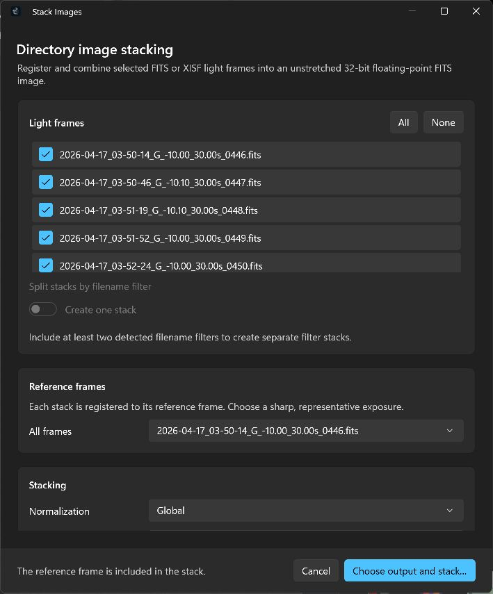

Seiza reports per-frame progress without blocking the viewer, writes an
unstretched 32-bit floating-point FITS result, and opens the completed stack
automatically. Completed files are published atomically, so a failed or
cancelled write cannot replace an existing output with a partial file. Seiza
also validates every output in a multi-filter batch before stacking begins and
identifies any files that were already saved if a later stack is cancelled.

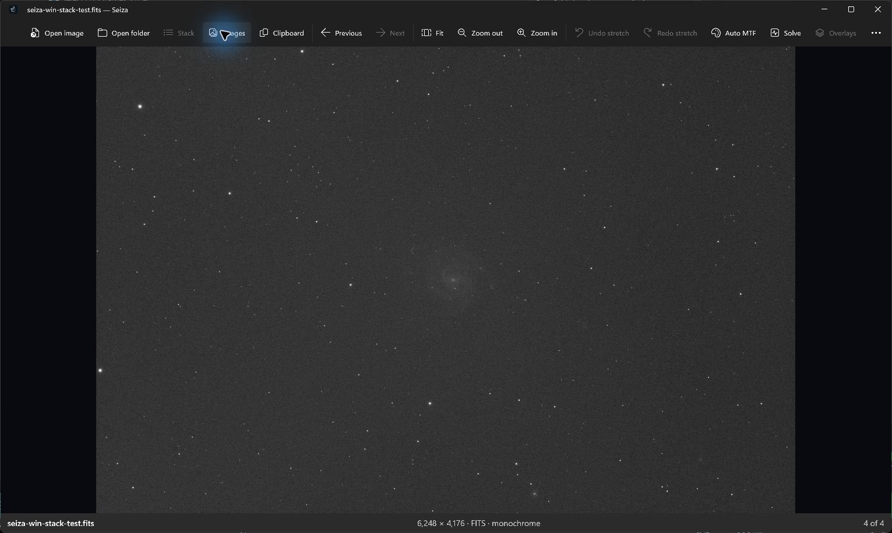

## Live folder stacking

Choose **Live Stack** to watch a capture folder while an imaging session is in
progress. Point it at the parent **LIGHT** folder: **Include subfolders** and
**Separate stacks by filter** are on by default. L, R, G, B and other filters
get independent live accumulators, calibration, counts, previews and checkpoints
in one session. New filter groups appear automatically as captures arrive;
an idle L stack does not prevent R from updating. Filter identity comes from
the image header, falling back to recognized filename tokens, not arbitrary
folder names. Files with neither are grouped as **Unfiltered**.

The **All filters** overview shows every discovered filter's latest preview,
frame counts and status together, including waiting, paused and failed stacks.
Tiles reflow as the window resizes and scroll for larger sessions. Select a tile
or use the filter picker to open its detailed preview and SNR chart; switch back
with the **Preview view** toggle. Snapshot and Finish require an individual
filter view, while Pause and save always applies to the whole session.

Change **Preview stretch (display only)** while running or paused to compare Auto
MTF, Median Anchor and Layered across all filters. New filters inherit the current
choice. These redraws never change the integrated linear pixels or exported FITS;
Layered defaults to linked color so both mono and RGB stacks work.

Seiza waits until each FITS or XISF file has stopped changing, checks
that it is a raw, compatible light frame, revalidates it against the active
masters, and registers it into a filter-locked stack. File-system notifications
keep the display responsive, while periodic full reconciliation catches files
that arrived while the folder or watcher was unavailable.

The live window provides a bounded autostretched preview, accepted/rejected
counts, calibration epochs, checkpoint health, and an SNR chart with measured
noise, background, and cumulative exposure when the headers provide it. You
can select a filter to inspect, save a non-destructive FITS snapshot, or finish
that accumulator without stopping the others. Save outputs outside the watched
capture tree to prevent exported stacks being ingested by another group. Native
startup/ingestion is limited to two simultaneous operations; each filter still
retains its own accumulator in memory. Choose Auto MTF, Median Anchor, or Layered
for the session's preview stretch. Finishing publishes
the final 32-bit floating-point FITS stack. When **Remove transients
after stacking** is on, finishing first reads every accepted frame again to
reject trails, so it takes longer; snapshots skip this step.

Live sessions checkpoint the exact registration, normalization, rejection,
calibration, and source-ledger state. **Pause and save** makes the session
resumable; startup validates the newest native context and manifest together
and can fall back to the previous complete generation after an interrupted
write. Existing or automatically built masters can be applied atomically as a
new calibration epoch. **Pause and save all** checkpoints every filter; finished
filters remain finished when the session is reopened. Automatic calibration
prepares masters separately for each filter. Turn **Separate stacks by filter**
off to resume an older single-filter session. Selecting no new calibration while
resuming preserves the masters recorded in the checkpoint.

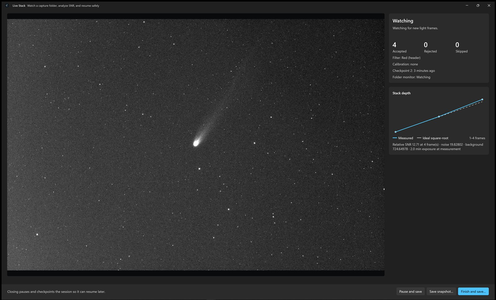

## Signed updater and installer

Seiza 0.1.3 established the signed in-app updater and fixed the installer's
post-install launch behavior:

- Fixed the installer's selected-by-default **Launch Seiza** action so Finish
  opens the installed app in the signed-in user's desktop session.
- The launch now uses WiX's unelevated shell action with the app's full
  installed path instead of a directory-relative executable command.
- Installed copies can discover, verify, and install later releases from
  **More > Check for updates** or **Settings > Check now**.

Other preview highlights still apply:

- GPU-backed FITS and XISF viewing with a cached thumbnail browser and
  image-anchored pan, wheel zoom, and pinch zoom.
- Nine stretch models, ordered adjustment stages, RGB strategies, automatic
  and manual background correction, live histograms, and Richardson-Lucy
  deconvolution.
- Local plate solving with WCS grids, deep-sky contours, named and field stars,
  transients, solar-system objects, and motion vectors.
- Full-resolution clean or overlay-composited export, FITS WCS sidecars, and
  image or processing-adjustment copy/paste.
- Native catalog download, verification, repair, and relocation UI.
- A self-contained, all-users MSI with FITS and XISF Windows file associations.

## Stretch and image processing

- Stretch FITS and XISF data with Auto MTF, Median Anchor, Layered, GHS, Percentile Asinh, Linear, Asinh,
  explicit MTF, or no stretch; stack and reorder stages with live previews,
  undo, and redo.
- Correct additive gradients or multiplicative illumination with adjustable
  strength and automatic, polynomial, or radial-basis background models; the
  flexible radial-basis option includes an extended-detail warning and is
  opt-in during automatic selection.
- Process linear astronomy data with three color strategies and conservative
  Richardson-Lucy deconvolution.
- Copy and paste a versioned set of Seiza processing adjustments through the
  Windows clipboard.

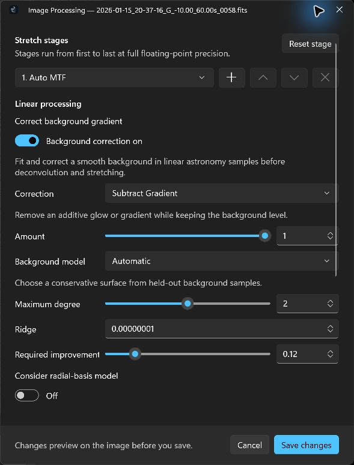

## Plate solving and sky overlays

- Blind-solve locally using downloaded catalogs, then draw a WCS grid, field
  center, named and field stars, deep-sky catalog objects and contours,
  transients, and solar-system motion overlays when their catalogs are present.
- Start solving from either the toolbar or the inspector, and export a solved
  TAN/TAN-SIP header as a standards-compatible FITS `.wcs` file.
- Inspect plate-solution quality alongside the image statistics and histograms.

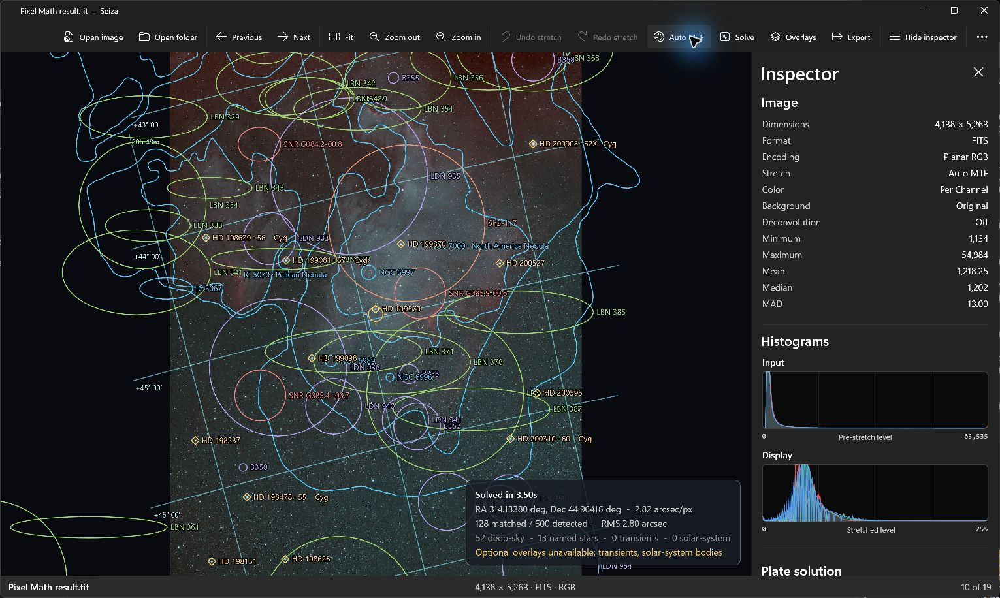

## Catalogs and distance data

Download, verify, repair, and relocate Seiza catalogs from the native Settings
window. The recommended preset includes deep-sky objects, transients, and
solar-system bodies as well as solving data.

For parallax video, **Download Offline Distances** installs stellar distances,
object distances, and the object catalog. Solving catalogs are a separate
requirement; installing distances does not replace them. Online stellar-distance
lookup is optional. See the [offline distance guide](docs/PARALLAX-VIDEO.md#offline-distances).

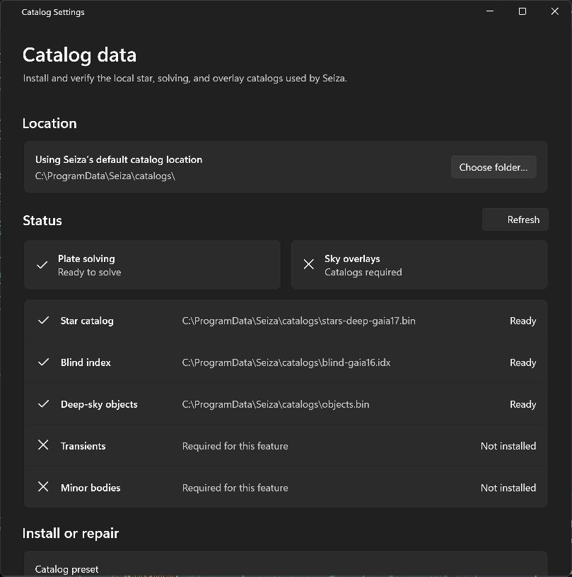

## Image export and Explorer integration

- Export the full-resolution stretched image as PNG, JPEG, or TIFF, either
  clean or composited with the currently visible overlays. FITS and XISF can
  be written as true 16-bit-per-channel PNG or TIFF without passing through the
  8-bit display bitmap.
- Copy and paste rendered images through the Windows clipboard.
- See autostretched FITS and XISF content thumbnails directly in Windows File
  Explorer after installing Seiza, and select a file to inspect the stretched
  image in Explorer's Preview Pane without opening the app. Read about the
  [native Explorer providers](#native-explorer-previews-and-thumbnails).

The maintained [feature-parity matrix](docs/FEATURE_PARITY.md) records the
remaining macOS and Windows integration work.

## Install

Download the [Seiza for Windows 0.8.6 x64 MSI](https://github.com/theatrus/seiza-win/releases/download/v0.8.6/seiza-0.8.6-windows-x86_64.msi).
Its [SHA-256 checksums](https://github.com/theatrus/seiza-win/releases/download/v0.8.6/SHA256SUMS.txt)
are published beside it. The installer places Seiza in
`Program Files\Seiza for Windows` for every user, adds a shared Start Menu
shortcut, and registers `.fit`, `.fits`, `.fts`, and `.xisf` with Windows
Default Apps. It also installs native Explorer thumbnail and Preview Pane
providers for those astronomy formats.

The MSI is fully self-contained. It includes .NET 10, the Windows App SDK/WinUI
runtime, Win2D, and the Cargo-locked Seiza Rust core, so installation and first
launch do not download or bootstrap a separate runtime. Windows will request
administrator approval because this is an all-users installation.

System requirements are Windows 11 24H2 or newer on an x64 computer. The MSI
and bundled first-party binaries are Authenticode signed by StackFoundry LLC.
The in-app updater also uses independent Ed25519 signatures to verify its feed
and MSI download.

Check for signed updates automatically or on demand from **More > Check for
updates** or **Settings > Check now**, then download, verify, and open an
in-place MSI update without visiting the Releases page.

## Open FITS and XISF in Photoshop

The separate [FITS and XISF Photoshop plugins](https://github.com/theatrus/xisf-photoshop)
let you open and save astronomy images directly in Photoshop using Seiza's codecs.
Import as Float32 or rescaled 16-bit integer, optionally debayer Bayer mosaics to
RGB, and save at the document's 16- or 32-bit depth by default.

Download the **Windows x64 installer** from the
[latest release](https://github.com/theatrus/xisf-photoshop/releases/latest).
Close Photoshop, run setup, approve the administrator prompt, and restart
Photoshop. Setup installs both formats in Adobe's shared plugin folder, handles
updates and detected older manual copies, and supports uninstall through Windows
Settings while preserving preferences. Starting with 0.5.0, the installer and
plugins are Authenticode signed by StackFoundry LLC. A plugin ZIP is also
available for manual installation.

Configure defaults under **Help → About Plug-In → FITS/XISF**. Starting with
plugin 0.5.0, same-format saves retain source headers and metadata; switching
formats copies compatible FITS keywords on a best-effort basis. Keep your original
FITS/XISF files: 16-bit import rescales the image and loses absolute scale and
precision. Re-solve astrometry after geometric edits, and use PSD/PSB to retain
Photoshop layers. See the
[metadata retention limits](https://github.com/theatrus/xisf-photoshop#metadata-retention).

## Build and test

Install:

- Visual Studio with the **WinUI application development** workload
- .NET 10 SDK
- Rust 1.99.1 with the `x86_64-pc-windows-msvc` target (pinned in
  `rust-toolchain.toml`, CI and release builds)

Then build the app and native core:

```powershell
.\scripts\build-rust.ps1 -Test
dotnet build Seiza.slnx
```

Build the self-contained all-users WiX MSI:

```powershell
dotnet build packaging\windows\Seiza.App.wixproj `
  -c Release `
  -p:SeizaVersion=0.8.6
```

The installer is written to `dist`. See the
[installer notes](packaging/windows/README.md) for its layout and smoke test.
The maintainer [release guide](docs/RELEASING.md) covers versioning, validation,
tagging, publication, and recovery. The [signed update guide](docs/AUTO_UPDATE.md)
documents the updater trust model and appcast generation.

## Architecture

WinUI 3 and C# own Windows lifecycle, controls, accessibility, and settings.
Win2D owns interactive image and vector-overlay presentation. The published
`seiza-cabi` Rust crate and its crates.io dependencies own decoding, FITS/XISF
processing, statistics, catalogs, WCS, and solving. `Cargo.lock` selects exact
versions, and the About dialog reports the C ABI version and packaged source
commit. A separate native Rust COM DLL renders FITS/XISF thumbnails and Preview
Pane images inside Windows' isolated shell-extension hosts; it does not load
WinUI, .NET, catalogs, or solving code.

See [Architecture](docs/ARCHITECTURE.md) for component boundaries and
performance rules.
