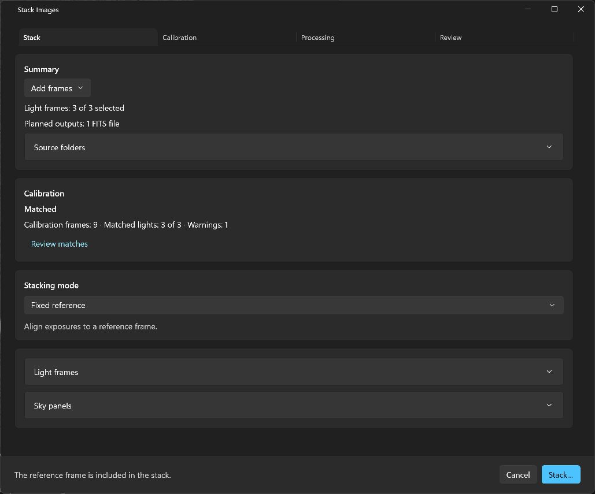
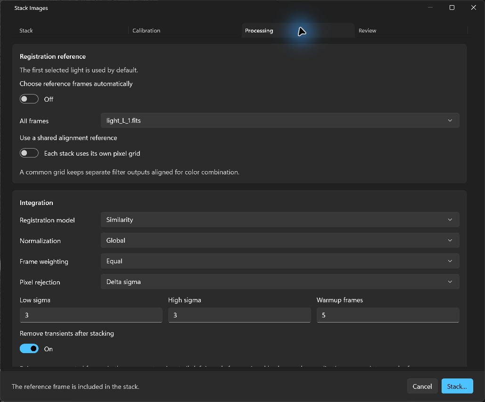

# Mac #96: simpler stacking setup

The Windows development branch follows merged [Mac PR #96](https://github.com/theatrus/seiza-mac/pull/96),
reviewed at `b1e31749440e585302b5a5d4c91bfe11252e0992`. These UI changes are not
in the published Windows 0.9.2 installer. The review is integrated with current
main: published Seiza/C ABI 0.49.0, calibration 0.12.1 and stacking 0.57.0.
This UI PR keeps that dependency set and the product version unchanged.

## Start directly from Stack

1. Choose **File → Stack images…** or **Stack…** in the toolbar. Use **Add frames**
   to choose images, a folder, or a TXT/CSV image list, or use a prefilled open
   collection. Both commands reuse the current document's setup window. Only
   FITS/XISF files become stack inputs; a raster viewer can open an empty setup.
2. Keep **Fixed reference** for repeated exposures of one field, or choose
   **Expanded mosaic** for overlapping fields. All detected lights are selected.
   Mixed collections provide calibration files and start matching automatically.
3. Wait for matching to finish, then choose **Stack…** and select an output.
   Masters are built or reused automatically and the saved FITS result opens
   in the viewer. Complete matching needs no review approval or additional tab.

The first tab shows selected-light/output counts, matching progress, calibration
frame and matched-light counts, warnings, and **Review matches**. Source folders,
import notes, individual lights and sky panels start collapsed. Splitting controls
appear when multiple filters are detected; header filters still take precedence
over filename guesses.

The review preserves current main's direct imports and standalone **Build
masters** workflow. File → Build calibration masters opens the same master
window as the toolbar. Added frames update counts and source folders; import
errors and cancellation messages expand immediately instead of staying hidden
inside collapsed import notes.

## Detailed controls

| Location | Controls |
| --- | --- |
| Calibration | Existing masters or Calibration files; individual files/library folder; Automatic or All compatible frames independently for flats and darks; incomplete-light policy; Matching and grading. |
| Processing | Registration reference, shared alignment, integration settings, and Registration and memory limits, including the expanded-canvas ceiling. |
| Review | Calibration frames, Light matches, Master plan and Flat groups. More → Refresh from files performs a manual refresh. Done returns to Stack. |
| Matching failure | The error and Try again appear on Stack. Retry is absent during normal automatic matching. |

These are settings pages, not a sequence of required steps. Windows uses sentence
case for control labels. The first selected light remains the reference by default;
automatic selection remains off. Processing defaults and native matching policies
are preserved. Sky-panel solving is optional for expanded mosaics.

The default incomplete-light policy still stops. Keep remains explicit. Exclude
checks every output group has at least two remaining lights before opening the
output picker, while native execution retains its own checks. Edits remain local
until stacking starts; cancellation does not save preferences. Source protection,
master reuse, per-light sessions, replay and the live-acquisition workflow are
unchanged.

## Validation

- 888 managed tests passed, including readiness checks for complete matching,
  Stop/Keep/Exclude, separate outputs, and unreviewed/stale coverage.
- Release solution build passed with zero warnings/errors. Self-contained
  publishing passed, and the native DLL runtime audit passed. The Windows
  graphics suite passed 96 tests with four existing optional-data/encoder skips;
  the first local run stalled and the bounded diagnostic rerun passed.
- Interactive review on 2026-11-08 used twelve generated 256 × 256 FITS fixtures:
  three lights plus three each of bias, dark and flat frames. The empty setup,
  File/toolbar entry points, Add frames choices, automatic 3-of-3 matching,
  Review matches → Done, reference defaults, fixed/expanded modes, registration
  and memory limits, Select all/Deselect all, cancellation and the standalone
  master-window menu entry were checked in the running app.
- The review host uses the same C#/XAML/native code with `AssemblyName=Seiza.Review`
  to avoid the computer-use helper confusing the preview with the installed
  `Seiza.App.exe`. The normal production-name publish also succeeded.
- Picker-driven import completion and a manual end-to-end fixed/expanded stack
  are not claimed. The system folder picker opened, but the helper could not
  target its separate `PickerHost.exe` window. Native and managed integration
  tests cover the underlying import, calibration and stacking services.

The bounded screenshots below show the reviewed UI with generated test inputs;
source folder paths remain collapsed. Local logs, fixtures and preview builds
are in ignored `artifacts/pr-review-2026-11-08`.

