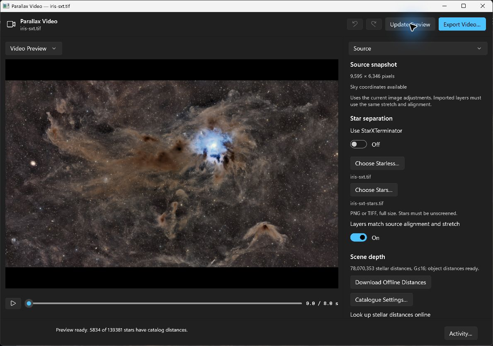

# Parallax video on Windows

The Windows editor follows the feature set in
[Seiza for macOS PR #56](https://github.com/theatrus/seiza-mac/pull/56), with native
WinUI controls and Windows video encoding. Scene preparation, depth assignment,
camera fitting, tour planning, labels, dust and frame rendering remain in the
shared Seiza Rust core; Windows does not reproduce those pixel algorithms.



## Workflow

Open an image and choose **Parallax Video**. The generator owns an independent
snapshot of the document's committed image-processing settings. Subsequent
viewer navigation does not change its source. Astronomy sources are rendered
through the shared processing pipeline into a temporary display-image snapshot;
the original FITS/XISF file is not modified. Already-rendered raster images use
Windows image codecs to make a lossless 16-bit PNG snapshot, normalizing EXIF
orientation without passing through the viewer's eight-bit display bitmap.

1. In **Source**, configure star separation and scene depth. Use a locally
   installed RC-Astro CLI (`rc-astro.exe`) licensed for StarXTerminator, selected
   once in **Settings > External tools** and remembered across launches, or
   choose aligned starless/stars layers. Manual layers must have the source
   dimensions, matching orientation and stretch; confirm their alignment
   before preparation. Alignment defaults on and importing/replacing layers
   preserves your choice, including an explicit off. Disabled preparation
   explains which input or alignment confirmation is missing.
   Neither RC-Astro's CLI nor StarXTerminator is bundled
   or installed by Seiza. The viewer's plate solution is reused, including a
   solution obtained after opening the video window. Otherwise FITS/XISF sources
   are solved from their original headers first, falling back to the selected
   stars layer; raster images use the pixel-aligned private snapshot/stars layer.
   The inspector reports whether stars confirmed the headers or a blind solve
   found the field. **Header coordinates (no confirming stars)** is an explicit
   warning, not a verified star match. Solving is cancellable with a two-minute
   limit on cores supporting the bounded solve API.
   If the opened source is successfully selected as Starless, it is remembered
   as a starless source even after replacing that layer. Without an existing
   solution, only the aligned Stars layer is solved: neither the starless
   original nor its snapshot is attempted. Missing Stars or alignment off
   blocks solving immediately with an explanation. This policy is shared by
   tour generation, preview preparation and export.
2. In **Camera**, choose **Fly In** or **Tour**. Pick destinations on the image
   or enter source-pixel coordinates. Prepare a bounded preview, scrub or play
   it, then adjust the camera. Camera-only edits reuse the prepared scene;
   scene changes require preparation again.
3. In **Labels**, configure object labels, custom point/radius labels, label
   colour, an optional credit and logo, and title cards.
4. In **Output**, choose the output format, dimensions, frame rate, codec and render
   quality, then **Export Video**. Export fits the full-resolution camera and
   renders its frames independently of the smaller interactive preview.

## Framing and source crop

Seiza 0.32 or newer adds **Framing** in Output: **Fill frame** fills the video,
cropping image edges as needed; **Fit whole image** preserves the entire filmed
image and adds black bars when its shape differs from the frame. **Match image
shape** instead computes even output dimensions from the source (or crop), with
a 720p, 1080p, 1440p or 4K long side. The preview uses a smaller explicit size;
it does not allocate a full-resolution image-shaped video.

In Source, **Draw crop** selects a source-pixel rectangle; optionally lock its
aspect to the output frame. Numeric values are applied together with **Apply
crop values**. A crop must be at least 16 pixels each way and inside the source.
**Use entire source** removes it. Cropping is undoable and rebuilds the scene;
framing edits only refit the camera. Neither operation modifies input images.
Camera points, labels and markers stay at their physical source-pixel positions;
native requests translate them to the crop exactly once. New stops and default
centres use the filmed rectangle. Saved Windows itineraries include the crop
and store crop-relative points; older itineraries use the current crop.


## Feature parity

### Tour-point framing

Generate Tour considers LBN nebulae. Its automatic selection ranks objects
within the filmed crop and skips targets that fill too much of the frame or
are too close to a higher-ranked stop. For example, LBN 625 spans 60 arcminutes
along its major axis. It can appear in a plate solve yet be too large for a
separate stop in a narrow field. Switching off **Automatic target count** can
include lower-ranked targets. To feature a particular object, add a stop and
use **Pick Destination** to place it.

New custom points start wide (Dolly 0%, Zoom 1×), independently of the previous
target. Adding, duplicating, reordering and deleting stops select the relevant
stop and seek to its arrival; the refitted preview uses that time.

Each stop has its own Dolly slider (0–99%, with a 0% reset) and Zoom slider
(0.1–8× in 0.05 steps, expanding to retain imported values, with a 1× reset).
Zoom changes lens magnification; Dolly moves through depth and changes how
near stars move against the nebula. A high Dolly can remain close at Zoom 1×.
Overall/opening/end zoom still has a minimum of 1× and independent resets.

**Pull Back** resets the selected stop's Dolly, Zoom, Pan and Push while
retaining its destination, name, depth and timing. It is undoable, unlike
**Use Whole Image**, which clears the destination.
With the native correction from [Seiza #283](https://github.com/theatrus/seiza/pull/283),
it also opts into `pullBackToWholeImage`: the camera widens toward the image
centre while keeping the selected target. Tighter Dolly/Zoom views move back
toward that target. New custom points and manual per-stop Dolly/Zoom edits use
the same mode, which round-trips with saved itineraries. Existing authored
tours default to their original point-centred behavior. Pull Back is disabled
on native cores that do not recognize the setting; imported tours requiring it
show an explicit unsupported-core message rather than silently changing framing.

Fill Frame may increase fitted zoom to keep image edges outside the video.
A stop below Zoom 1× offers **Show Whole Image for Entire Video** explicitly;
this changes the whole video's framing and permits black space for wider views.
The preview inspector lists requested versus fitted adjustments.

The native correction in #283 also keeps fitting local to stops instead of
magnifying the whole tour. Windows regression coverage verifies unchanged
opening pixels and global zoom after pulling back an off-centre target, with
glide 0 and 0.2. Show Whole Image remains a separate, explicit framing choice,
not the fix for the Fill Frame coupling. Windows uses published Seiza/C ABI
**0.38.0**, including both #283 and #277's source-space cropped-dust correction.
For two-stop turns, fitting can add temporary magnification between the stops
while preserving their endpoint lenses. The preview inspector reports this as
**Transition zoom**. Endpoint spins are fitted throughout their holds.

### Shared composition controls

The editor exposes the same composition controls as the Mac implementation:

- Fly-in timing, start framing, dolly, pan, opening/end zoom, start/end roll,
  sideways swing and direction, and easing.
- Automatic tours with target count, hold and motion controls; editable stops
  with point/whole-image focus, optional target depth, travel and hold, zoom, dolly, pan, roll, spin,
  push, optional titles and title cards; stop insertion, duplication,
  reordering and removal.
- Tour glide, titles, looping and JSON itinerary load/save. Shared schema-1
  itineraries remain portable; an itinerary is not a complete project archive
  and does not embed source images or separated layers.
- Distance reference, explicit background/unmatched-star distances, optional
  online stellar distances, Gaia magnitude depth and optional distance/object
  input files.
- Moving-star limit, remaining-star policy, background galaxies, dust dimming,
  dust maps, star growth/fade controls, catalogue/custom labels, credit, logo
  and title cards.
- Automatic and custom mask-defined depth planes, with the planes found listed
  and distances given for any named catalogued object in place of the catalogue's.
- Undo/redo, fitted-camera warnings, bounded automatic camera previews,
  timeline playback, progress/activity reporting and cancellation.

Windows uses native file pickers and reveals a completed export in Explorer.
Platform-specific application chrome and encoder availability differ from
macOS; the shared scene and camera semantics do not.

## Dust maps

Dust dimming normally counts the dust from how few stars show through it. A
**dust map** replaces that count with an image painted white where the dust is
opaque and black where the sky is clear, at any size with the image's shape,
as PNG, JPEG, TIFF, FITS or XISF. What lies behind the nebula dims by the map,
and where it lets through 5% of the light or less (about 96% white) nothing
behind can show, so a star seen there flies in front of the nebula.

- **Export Dust Map…** writes the dust in use, the size of the image: a 16-bit
  PNG or TIFF, or a 32-bit float FITS or XISF. Paint over it in an image editor.
  An exported counted map can carry small opaque specks in clear sky; paint
  them out, or the stars under them fly forward. Exports cannot replace source
  images or selected inputs; a failed or cancelled export leaves an existing
  destination unchanged.
- **Choose…** under *dust map* applies a map. On a prepared scene only the dust
  changes: the scene is not prepared again, and the preview keeps its camera.
- **Reload** reads the chosen map again after it was edited elsewhere.
- **Reset** returns to the dust counted from the stars.
- **Paint Dust Map…** opens a private mask draft over the source image. Paint
  opaque dust or clear sky with a soft brush, choose its diameter and strength,
  view the mask alone, and undo/redo up to 20 strokes. **Reset edits** restores
  the map that was opened. Only **Apply** changes the scene; Cancel leaves it
  unchanged. The editor is bounded to 768 pixels on its longer side and stores
  an applied map as a private 16-bit PNG, so later scene preparations retain it.
- **Dust map to export** chooses the current map or the original dust counted
  from stars, without first removing a painted or imported map.

The *Stars and dust* section says where the dust came from and how many stars
the map brought in front. The map path lives with the open window, like the
other input files; tour itineraries do not record it. Dust maps need dust
dimming on.

Dust maps and plane masks span the original source, not the crop. With the
upstream cropped-dust correction, reading, painting, reloading and exporting
dust all use source coordinates; exported pixels outside the filmed crop are
clear because no dust was estimated there. This correction must be available
in the released native dependency before cropped dust editing ships.

## Depth planes

With **Automatic depth planes** on, catalogued nebulae that lie at least 15%
nearer or farther than the nebula move on planes of their own, at their own
distances. A dark nebula moves with the cloud of dust it lies in. A cloud that
holds the nebula stays with it; a cloud at least 15% in front of the nebula
moves as one plane, placed by its dark nebulae's catalogued distances or, where
the catalogue has none, by where the Gaia stars seen through it run short.
Planes need the object catalogue and the object distance file
(`object-distances.bin`); without them the scene is prepared with no planes and
a warning says why.

After preparation the *Depth planes* section lists each plane: its distance and
how it was found, the share of the image it covers, and whether it is a dark
cloud that blocks the light behind it. When the field has none, it says so.
*Preparation details* names the dark nebulae that stay with the nebula's own
dust.

- **Distance (pc)** on a plane named after a catalogued object gives that
  object a distance in place of the catalogue's. It applies when the scene is
  prepared again; until then the list shows what the last preparation found.
  Given for the nebula itself, a distance also sets the nebula's.
- **Reset** drops the distance given.
- **Add Object Distance…** gives a distance to any object by catalogue name,
  replacing an existing override regardless of case. This can explicitly lift
  a large object that automatic plane selection otherwise keeps on the background.
- **Add Plane Mask…**, under *Custom depth planes*, chooses a white-on-black
  image, an optional name and a positive distance in parsecs. Masks may have a
  different resolution but must match the source's shape. Change or remove each
  plane independently; custom masks work without automatic planes or catalogues.
- A cloud of dust that no catalogued object names, placed by the star counts,
  shows its distance but cannot be given one.
- A distance given for an object that is no longer a plane, for instance one
  moved to within 15% of the nebula, stays under *Other distances you gave*
  until it is reset.

Planes and given distances are scene settings, with undo: changing either
requires preparing the scene again. A tour stop normally centres on the plane
under its point; **Set target plane distance** overrides that camera target
depth without moving the scene's planes. Itineraries preserve explicit stop
depths (`depthParsecs`), but do not record scene masks or object-distance overrides.
Seiza 0.30.1 supplies the prepared-scene planner used below.

Once a scene is prepared, generating a tour plans it on that scene, for the
full output size: each stop keeps the depth of the plane the scene shows its
target on, and no image is solved. Applying such a tour leaves the distance
reference alone, so the scene is not prepared again. Before a scene is
prepared, a tour is planned from the catalogue alone, and applying it moves the
distance reference to its chief target. Moving a stop's point drops its depth.

Behind a lifted plane the image keeps only a smooth fill. Where a tour stop
would show much of it, the fit flies that stop less far and zooms in to keep
its target's size; the *Preview* section lists the change as the stop's dolly.

## Logo and title cards

Images with transparency, PNG or TIFF, can go over the video as well as text.

- **Logo**, in the *Credit* section, draws an image in the credit's corner of
  every frame. **Logo size** is its height as a share of the frame's shorter
  side, 0.06 by default; it is never wider than a third of the frame. With
  credit text too, the logo sits just inside the text. **Corner** and
  **Opacity** move and fade the credit text and the logo alike.
- **Opening card** and **Closing card**, in the *Title cards* section, show a
  card over the start and the end, each for **Card seconds**. The opening card
  shows whole from the first frame and fades out; the closing card fades in for
  the end. A looping tour shows both across its join, so it still loops.
- **Title card** on a tour stop shows a card during that stop, with the timing
  a title has, in place of the title. It shows whether or not *Show stop
  titles* is on.

A card is fitted inside the frame and centred. Make it the video's size, such
as 1920 × 1080, for sharp lettering. A card without transparency hides the
frame while it shows, and one of another shape than the frame shrinks to fit;
preparation warns of both. A file that cannot be read stops preparation with
its name. Itineraries record each stop's card by its path; the logo and the
opening and closing cards live with the open window.

## Offline distances

**Download Offline Distances** selects exactly these published datasets:

- `star-distances.bin`
- `object-distances.bin`
- `objects.bin`

This is a focused download, not the solver's **Everything** preset. It does not
fetch the optional G≤20 star catalogue. Solving catalogues still need to be
available when an image needs solving; installed distance data does not replace
them. The displayed stellar magnitude coverage comes from the native database
header. Default-directory status follows the shared core's environment overrides
and legacy fallback paths; an explicitly selected directory is checked as-is.
Choosing a deeper Gaia limit than that coverage produces a warning.
Object-distance readiness also requires a readable, fingerprint-matched
`objects.bin`. Missing or corrupt pinned environment overrides show their actual
path and variable; downloading to another directory cannot repair those choices.

The platform adapter delegates manifest loading, transfer, decompression,
SHA-256 checks and installation to the published `seiza-download` crate. It
explicitly re-verifies cache hits. A checksum/size failure can evict only the
failed selected cache file, after checking its expected metadata and canonical
cache-directory containment, and then reacquire it through the downloader.
Other cache files and installed source data are not cleared. Each selected
artifact gets at most one repair attempt per download operation; persistent
failure is reported rather than retried indefinitely.

## Native video export and safety

MP4 movies are silent SDR files, encoded through Windows Media Foundation's
WinRT `MediaStreamSource`/`MediaTranscoder` APIs. H.264 and HEVC are available as
choices, with hardware acceleration allowed. HEVC requires an encoder available
to the Windows media stack; if unavailable, Seiza reports the failure and
suggests H.264 rather than downloading a codec or using an external encoder.

**MOV** and **Matroska / MKV** use an optional installed FFmpeg. Choose its
executable in Output or leave it unset to search PATH. Seiza never downloads or
bundles FFmpeg. H.264 needs `libx264` or `libopenh264`; HEVC needs `libx265`.
Frames stream directly to the encoder with one reusable buffer. Cancellation
terminates and joins the child process before cleanup; no shell is involved.

**PNG sequence** writes lossless, top-down `frame-00000.png`, `frame-00001.png`,
and so on. Enter a new sequence folder name, then choose its parent on export.
Only the complete sequence is published; existing folders are never cleared,
merged into, or replaced. No video encoder or FFmpeg is needed.

The export limits match the Mac implementation: even width/height from 16 to
3840 pixels, 1–60 frames per second and 2–36,000 frames. Bitrate is at least
2 Mbit/s, otherwise width × height × FPS ÷ 2. Input/output colour metadata uses
Rec.709 primaries/matrix with the source display pixels' sRGB transfer function.

Frames are rendered only when the encoder requests them. At most six reusable
BGRA buffers are allocated; a buffer is not reused until Windows reports its
sample processed. Timestamps derive from the rational frame index/FPS, avoiding
accumulated frame-duration rounding. Neither a movie-sized frame array nor a
directory of temporary frame images is created.

The encoder writes a unique sibling staging MP4 and closes/finalizes it before
atomically replacing the chosen destination. Cancellation or a render/encode
failure leaves an existing destination untouched and removes the staging file.
The Windows App SDK path-only save picker does not create or truncate the
destination before this staging operation.
Cancellation is connected to both the Windows async operation and blocked frame
production; callback work is joined before its native source is released. Some
synchronous core stages must finish their current call before closing completes.
MOV/MKV use the same completed-file publication policy; PNG stages a unique
sibling directory. All formats check source images, layer files, artwork, plane
masks and selected encoder executables for direct or file-identity aliases
before encoding and again before publication.
Inputs selected earlier in the same window remain protected after replacing a
map, artwork or mask and preparing a new scene; export to a different filename.

Windows Media Foundation can report an MKV's frame rate as half its actual
rate. Validation therefore checks Matroska's `DefaultDuration`, independently
decoded frame timestamps/count/duration, and timed Windows-decoded pixels;
it does not rely on that Windows metadata field. The generated files retain
the selected frame rate. MOV/MP4 metadata does not show this discrepancy.

## Validation

The Windows-runtime encoder tests produce and decode a real H.264 MP4, checking
dimensions, FPS, duration, exact encoded sample count, absence of audio, channel
colours, top-down frame orientation and the six-buffer bound. They also exercise producer exceptions,
already-cancelled work, cancellation after submission, and cancellation while
the media pipeline waits for a blocked producer, checking previous-output
preservation and staging cleanup. Rational timing and invalid limits are tested
separately. On a machine without HEVC, its actionable failure and output
preservation are tested instead of pretending an HEVC movie was encoded.

A native-core integration test prepares real `ParallaxVideo` handles from
deterministic separated PNGs and sends them through the production Windows
encoder overload, then decodes the movie and verifies source-file immutability.
An opt-in real-source test also prepares the supplied 9,595 × 6,346 Iris TIFF
layers entirely offline, exports and decodes a 1280 × 720, 48-frame H.264 movie
at 24 fps, and verifies SHA-256 hashes of every original source-folder file.
Diagnostic frames and movies are written outside the source folder. Raster
snapshot tests verify sub-eight-bit distinctions, TIFF/JPEG EXIF orientation and
collision refusal.

The same Iris layers were also imported, prepared, played and exported through
the native editor. The GUI-generated movie was independently decoded and checked
for 1280 × 720 dimensions, 48 H.264 frames at 24 fps, two-second duration, correct
orientation and no audio. This offline validation uses explicit illustrative
background/unmatched-star distances, not a downloaded per-star distance database.

The 0.8.0 manual-layer solving regression was also checked interactively with
the starless Iris TIFF open in the viewer and both aligned layers selected.
Preparation solved sky coordinates from the imported stars, detected 139,381
stars and matched 5,834 to the installed offline distance catalog. The independent
workspace remained usable after closing the source viewer.

Native adapter tests use local manifest/file fixtures without downloading data:
they check exact three-file selection, compressed progress accounting, missing
or corrupt database status, stellar header depth, cache re-verification,
targeted repair/recovery, concurrent-repair preservation and unrelated-file
protection. These automated checks complement, rather than replace, native UI
inspection and end-to-end export with real astronomy data.

```powershell
cargo test --package seiza-platform --release --locked
dotnet test tests\Seiza.App.Windows.Tests\Seiza.App.Windows.Tests.csproj -c Release
dotnet test tests\Seiza.App.Tests\Seiza.App.Tests.csproj -c Release
```

To include the opt-in real TIFF corpus (otherwise the real-source test is skipped):

```powershell
$env:SEIZA_PARALLAX_SOURCE_DIRECTORY = 'C:\Users\atrus\Dropbox\parallax\sources\iris'
$env:SEIZA_PARALLAX_OUTPUT_DIRECTORY = "$PWD\artifacts\parallax-real-qa"
dotnet test tests\Seiza.App.Windows.Tests\Seiza.App.Windows.Tests.csproj -c Release
```

`SEIZA_PARALLAX_EXISTING_MOVIE` separately enables the diagnostic for an existing
1280 × 720, 24 fps, two-second GUI H.264 export. That diagnostic is skipped when
the variable is unset and writes decoded previews to the output directory.
