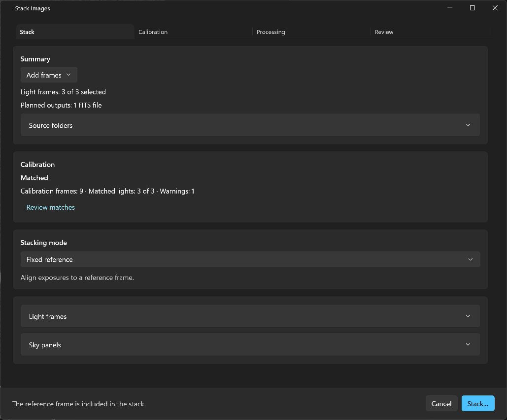
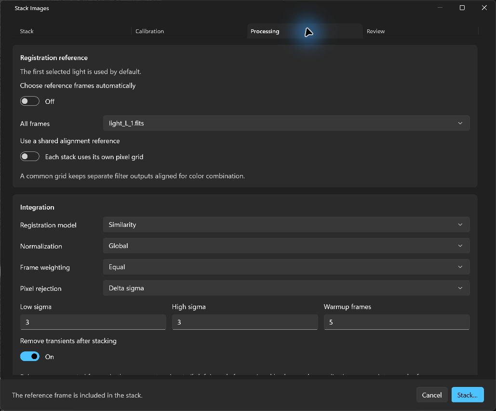

# Seiza for Windows 0.9.3

Start a stack or prepare calibration masters without first opening a collection
in the viewer. This release simplifies stacking setup and updates the shared
imaging core to Seiza 0.49.0.

## Stacking and calibration

- Choose **File → Stack images…** or **Stack…** in the toolbar, then **Add
  frames** to import images, a folder, or a TXT/CSV image list. An open collection
  still prefills the inputs, including mixed light and calibration files.
- The Stack tab summarizes selected lights, planned outputs and automatic
  calibration matching. Complete matching needs no review approval; **Review
  matches** opens the evidence, and **Done** returns to Stack.
- Keep **Fixed reference** for one field or choose **Expanded mosaic** for
  overlapping fields. References and memory limits are in Processing. Frame
  lists and less-used details stay in collapsed sections.
- The default stops when lights have incomplete calibration. Choosing Exclude
  requires at least two calibrated lights in every planned output before
  choosing the output location.
- Choose **File → Build calibration masters…** or **Build masters…** in the
  toolbar to build bias, dark/dark-flat and flat masters independently. The
  separate window supports direct imports, cancellation, calibration
  dependencies and protected publication of output masters.

Import messages are visible, source-folder summaries refresh after imports,
empty inputs report no planned outputs, and fractional controls show readable
defaults. Existing setup windows reactivate from either the menu or toolbar.

## Imaging core and installer

The app now uses published Seiza/C ABI 0.49.0, stacking 0.57.0, FITS 0.8.0,
XISF 0.9.0, image I/O 0.13.0 and parallax 0.20.0.

The installer remains self-contained and retains the 0.9.2 fixes for Windows
without the Visual C++ Redistributable and recovery from failed legacy installs.

The production workflow tests and signs the native binaries and MSI, verifies
the signed files inside the installer, checks native loading without VC++
runtime resolution, and publishes the signed updater feed and SHA-256 checksums.
